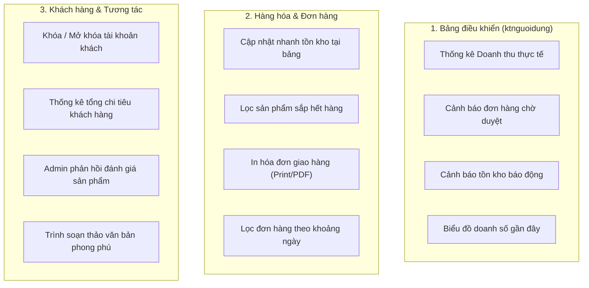

# KẾ HOẠCH ĐÁNH GIÁ & NÂNG CẤP TOÀN DIỆN HỆ THỐNG QUẢN TRỊ (ADMIN)

> **Dự án**: Website Thương mại Điện tử GymBro (`QLDAPM_Nhom04`)  
> **Mục tiêu**: Đánh giá độ nhất quán giữa các thư mục quản trị (`admin/ql*`), nhận diện các tính năng còn thiếu / cần cải thiện, và lập lộ trình triển khai rõ ràng, tối ưu trải nghiệm vận hành cho Quản trị viên và Nhân viên.

---

## 1. BẢNG ĐỐI CHIẾU & ĐÁNH GIÁ ĐỘ NHẤT QUÁN CÁC THƯ MỤC `admin/ql*`

Hệ thống hiện tại gồm **11 module quản lý** thuộc thư mục `admin/`:
`ktnguoidung` (Bảng điều khiển & Hồ sơ), `qlnhansu`, `qlchisoBMI`, `qldanhmuc`, `qlsanpham`, `qlthuonghieu`, `qlvoucher`, `qlkhachhang`, `qldonhang`, `qldanhgia`, `qltintuc`.

| Thư mục Module | Cấu trúc File | Cơ chế Sửa bản ghi | Tiền tố Class CSS | Chuẩn Flash Alert | Phân quyền Xóa (Admin) | Ràng buộc an toàn khi xóa |
| :--- | :--- | :--- | :--- | :--- | :---: | :---: |
| **`ktnguoidung`** (Dashboard) | `index, main, hoso, dangnhap, doimatkhau` | Form riêng | `.gb-*` | Array | Không có xóa | Không |
| **`qlnhansu`** | `index, main, sua` | Trang riêng `sua.php` | ⚠️ `.ns-*` | ⚠️ String | ✅ Admin | Không xóa tài khoản đang đăng nhập |
| **`qlchisoBMI`** | `index, main, sua` | Trang riêng `sua.php` | `.gb-*` | Array | ✅ Admin | Chỉ xóa khi không vướng cấu hình |
| **`qldanhmuc`** | `index, main, sua` | Trang riêng `sua.php` | ⚠️ `.dm-*` | ⚠️ String / `loi` | ✅ Admin | Chặn xóa nếu còn sản phẩm |
| **`qlsanpham`** | `index, main, sua` | Trang riêng `sua.php` | `.gb-*` | ⚠️ String / `loi` | ✅ Admin | Chặn xóa nếu đã có trong đơn hàng |
| **`qlthuonghieu`** | `index, main` | Modal Popup | `.gb-*` | Array chuẩn | ✅ Admin | Chặn xóa nếu còn sản phẩm |
| **`qlvoucher`** | `index, main` | Modal Popup | `.gb-*` | Array chuẩn | ✅ Admin | Tự chuyển sang Tạm dừng nếu đã dùng |
| **`qlkhachhang`** | `index, main, sua, chitiet` | Trang riêng & Chi tiết | `.gb-*` | Array chuẩn | ✅ Admin | Bảo vệ tài khoản khách |
| **`qldonhang`** | `index, main, chitiet` | Chi tiết & Modal Vận chuyển | `.gb-*` | Array chuẩn | ✅ Admin | Chỉ xóa đơn hủy/lỗi |
| **`qldanhgia`** | `index, main` | Duyệt / Ẩn trực tiếp | `.gb-*` | Array chuẩn | ✅ Admin | Xóa đánh giá spam/vi phạm |
| **`qltintuc`** | `index, main` | Modal Popup | `.gb-*` | Array chuẩn | ✅ Admin | Cho phép xóa bài nháp/cũ |

### Nhận xét về độ nhất quán hiện tại:
1. **Kiến trúc chỉnh sửa (Modal vs Trang riêng `sua.php`)**:
   - Các bảng dữ liệu nhiều trường (Sản phẩm, Khách hàng, Nhân sự) dùng trang riêng `sua.php` hoặc `chitiet.php` là hợp lý vì không gian hiển thị rộng rãi, tránh modal quá dài.
   - Các bảng danh mục/nhãn hàng gọn nhẹ (`qlthuonghieu`, `qlvoucher`, `qltintuc`) dùng **Modal Popup** giúp thao tác nhanh không cần chuyển trang.
2. **Sự không đồng nhất về CSS Class tiền tố**:
   - `qldanhmuc` vẫn đang dùng class `.dm-title`, `.dm-stat-card`, `.dm-icon-box`.
   - `qlnhansu` vẫn đang dùng class `.ns-title`, `.ns-stat-card`, `.btn-ns-primary`.
   - Trong khi toàn bộ các trang còn lại đã chuẩn hóa sang hệ thống chung **`.gb-title`**, **`.gb-subtitle`**, **`.gb-stat-card`**, **`.gb-icon-box`**, **`.gb-stat-label`**, **`.gb-stat-number`**.
3. **Cơ chế lưu Flash Message trong Session**:
   - `qldanhmuc` và `qlsanpham` đang lưu: `$_SESSION["thongbao"] = "chuỗi"` và `$_SESSION["loi"] = "chuỗi"`.
   - Các trang mới đang lưu mảng đối tượng: `$_SESSION["thongbao"] = ["loai" => "success/danger/warning/info", "noidung" => "..."]`.
   - Cần chuẩn hóa cơ chế flash message để tương thích 100% với nhau và với `admin/inc/footer.php` (tự động ẩn sau 10s).
4. **Quy tắc an toàn giao diện (Data Privacy & UX)**:
   - Các bảng đều đã tuân thủ chuẩn không lộ raw ID database, sử dụng cột **STT** tăng dần.
   - Sidebar item đã đồng nhất dùng cú pháp inline `(strpos($_SERVER['SCRIPT_NAME'], '<module>') !== false) ? 'active' : ''`.

---

## 2. NHỮNG TÍNH NĂNG CÒN THIẾU & CẦN NÂNG CẤP THEO TỪNG MODULE

### 🔴 1. Bảng điều khiển trung tâm (`admin/ktnguoidung/main.php`) — *ƯU TIÊN CAO NHẤT*
- **Hiện trạng**: Chỉ đếm số lượng Danh mục, Sản phẩm, Nhân sự và trạng thái server. Chưa hiển thị các chỉ số kinh doanh sống còn.
- **Tính năng cần bổ sung**:
  - **KPI Doanh thu**: Doanh thu hoàn thành hôm nay, Doanh thu tháng này, Tổng doanh thu shop.
  - **KPI Đơn hàng**: Số đơn hàng mới đang chờ duyệt (kèm link nhảy thẳng vào duyệt đơn).
  - **KPI Khách hàng**: Số lượng khách hàng thành viên đăng ký.
  - **Cảnh báo Tồn kho khẩn cấp**: Widget liệt kê danh sách các sản phẩm có tồn kho $\le$ 5 để thủ kho/nhân viên kịp thời nhập hàng.
  - **Biểu đồ doanh thu gần đây**: Biểu đồ đường hoặc cột trực quan hóa biến động doanh số 7 ngày gần nhất.
  - **Top 5 Đơn hàng mới nhất** và **Top 5 Đánh giá mới nhất**: Cho phép Admin/Staff xử lý tức thì từ trang chủ.

---

### 🔴 2. Quản lý Đơn hàng (`admin/qldonhang`) — *ƯU TIÊN CAO*
- **Hiện trạng**: Đã có danh sách, chi tiết, duyệt vận chuyển và lọc trạng thái.
- **Tính năng cần bổ sung**:
  - **In Phiếu giao hàng / Hóa đơn bán lẻ (Print Invoice Template)**:
    - Khi chuẩn bị gửi hàng, nhân viên bấm **"In phiếu giao hàng"** để xuất bản in A4/A5 sạch sẽ gồm logo GymBro, mã đơn barcode/QR, thông tin người nhận, danh sách hàng, phí ship, tổng tiền và chữ ký người nhận.
  - **Lọc đơn theo khoảng ngày**: Từ ngày... Đến ngày... (hỗ trợ kế toán chốt sổ kỳ kinh doanh).
  - **Xuất dữ liệu đơn hàng (Export CSV / Excel)**: Xuất danh sách đơn phục vụ báo cáo.

---

### 🟡 3. Quản lý Hàng hóa & Kho (`admin/qlsanpham`) — *ƯU TIÊN TRUNG BÌNH*
- **Hiện trạng**: CRUD chi tiết sản phẩm, tải ảnh, phân loại.
- **Tính năng cần bổ sung**:
  - **Bộ lọc kho hàng nhanh (Stock Filters)**: Thêm các nút lọc nhanh: *Tất cả*, *Sắp hết hàng ($1 \le \text{tồn} \le 10$)*, *Đã hết hàng ($\text{tồn} = 0$)*.
  - **Cập nhật nhanh tồn kho (Quick Stock Update)**: Cho phép click sửa số lượng tồn kho trực tiếp ngay tại bảng danh sách hoặc qua modal nhỏ, không cần mở cả trang `sua.php` dài.
  - **Huy hiệu hết hàng nổi bật**: Sản phẩm hết hàng tự động đổi sang badge đỏ cảnh báo.

---

### 🟡 4. Quản lý Khách hàng (`admin/qlkhachhang`) — *ƯU TIÊN TRUNG BÌNH*
- **Hiện trạng**: Xem danh sách, xem chi tiết địa chỉ, hồ sơ BMI, lịch sử mua hàng.
- **Tính năng cần bổ sung**:
  - **Khóa / Mở khóa tài khoản khách hàng**: Nút toggle đổi trạng thái `trangthai` (1 Hoạt động $\leftrightarrow$ 0 Bị khóa) để ngăn chặn các tài khoản spam hoặc vi phạm chính sách đặt hàng ảo.
  - **Thống kê Tổng chi tiêu (LTV)**: Hiển thị tổng số tiền khách đã mua sắm thành công và gắn huy hiệu khách hàng thân thiết (VIP / Thường).

---

### 🟢 5. Quản lý Đánh giá (`admin/qldanhgia`)
- **Hiện trạng**: Ẩn/hiện kiểm duyệt, lọc theo số sao.
- **Cải thiện đề xuất**:
  - Thao tác hàng loạt (Bulk action): Nút "Duyệt tất cả đánh giá đang chờ" hoặc "Xóa nhiều đánh giá đã chọn".
  - Hiển thị badge đánh giá từ khách hàng "Đã mua hàng thực tế" (Verified Buyer).

---

### 🟢 6. Quản lý Tin tức (`admin/qltintuc`)
- **Hiện trạng**: Dùng `textarea` để nhập nội dung.
- **Cải thiện đề xuất**:
  - Tích hợp trình soạn thảo định dạng phong phú trực quan (Rich Text Toolbar) hỗ trợ in đậm, in nghiêng, tiêu đề đoạn, gạch đầu dòng và trích dẫn để bài viết cẩm nang thể hình hiển thị chuyên nghiệp.

---

## 3. LỘ TRÌNH TRIỂN KHAI ĐỀ XUẤT (ACTION PLAN)

| Giai đoạn | Nội dung công việc | Mục tiêu đạt được | Mức độ ưu tiên |
| :--- | :--- | :--- | :---: |
| **Phase 1** | **Chuẩn hóa nhất quán toàn bộ Admin & Nâng cấp Bảng điều khiển** • Chuẩn hóa CSS `.gb-*` cho `qldanhmuc` & `qlnhansu` • Chuẩn hóa xử lý thông báo `$_SESSION["thongbao"]` • Nâng cấp `ktnguoidung/main.php` (KPIs doanh thu, đơn mới, tồn kho cảnh báo, danh sách xử lý nhanh) | Toàn bộ 11 module đạt 100% độ nhất quán giao diện; Dashboard có dữ liệu kinh doanh trực quan | 🔴 **Cao nhất** |
| **Phase 2** | **Nâng cấp Quản lý Đơn hàng & Kho vận** • Xây dựng tính năng "In hóa đơn / Phiếu gửi hàng" trong `admin/qldonhang/chitiet.php` • Thêm bộ lọc ngày (Từ ngày - Đến ngày) cho đơn hàng • Thêm bộ lọc "Sắp hết hàng / Hết hàng" trong `admin/qlsanpham` | Nhân viên đóng gói và giao hàng thuận tiện; Thủ kho kiểm soát hàng tồn chặt chẽ | 🔴 **Cao** |
| **Phase 3** | **Hoàn thiện Khách hàng & Tương tác** • Thêm tính năng Khóa / Mở khóa tài khoản trong `qlkhachhang` • Tính tổng chi tiêu và hạng thành viên • Nâng cấp trải nghiệm soạn thảo nội dung tin tức `qltintuc` | Quản trị viên kiểm soát tốt tài khoản và chất lượng nội dung tin bài | 🟡 **Trung bình** |

---

## 4. QUY TẮC BẢO TOÀN HỆ THỐNG KHI THỰC HIỆN
1. **Giữ nguyên luồng xử lý và dữ liệu hiện tại**: Các tính năng nâng cấp chỉ mở rộng thêm trên nền tảng sẵn có, không làm thay đổi hay phá vỡ database schema gốc của `gymshop.sql`.
2. **Không nạp trùng Bootstrap**: Toàn bộ modal, dropdown, collapse đều dùng `app.js` và bundle có sẵn.
3. **Phân quyền chặt chẽ (RBAC)**: Chỉ Quản trị viên (`loai = 1`) mới được khóa tài khoản, xóa đơn hàng, hoặc quản lý nhân sự. Nhân viên (`loai = 2`) chỉ thực hiện thao tác duyệt, cập nhật trạng thái kinh doanh.

